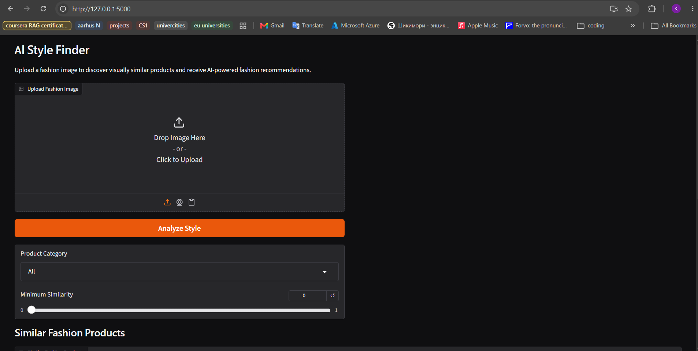
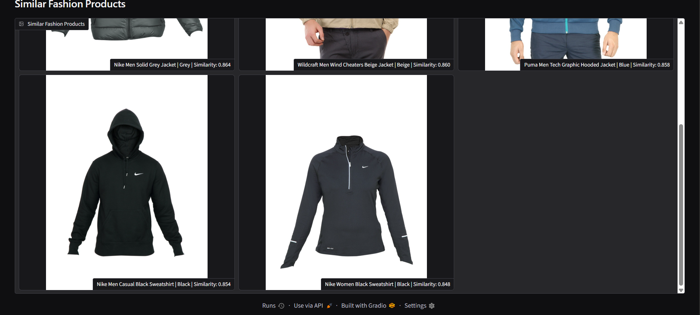
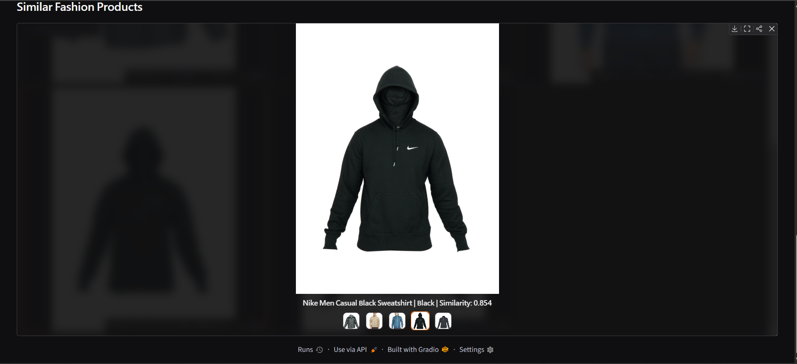
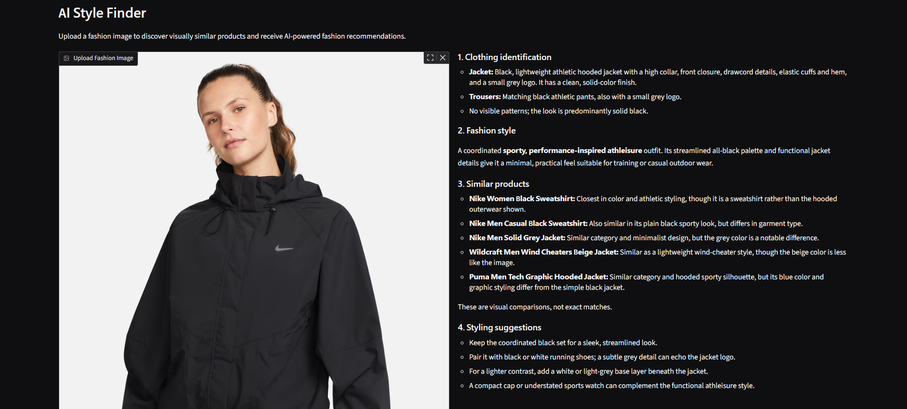

# AI Style Finder — Fashion Recommendation System
An AI-powered fashion recommendation application that uses computer vision, semantic image embeddings, and multimodal large language models to identify visually similar clothing products and provide personalized fashion analysis.
Built with **Python, OpenAI CLIP, PyTorch, Hugging Face, Gradio, and the OpenAI API**.








## Overview
AI Style Finder allows users to upload a clothing image and discover visually similar fashion products from a catalog of up to approximately 44,000 items.
The application uses a pretrained CLIP model to convert images into vector embeddings, compares them using cosine similarity, and retrieves the closest matching products.
An OpenAI vision model can then analyze the uploaded image, describe its visual characteristics, and generate styling recommendations using the retrieved product information.

## Key Features
- **Image-Based Fashion Search:** Upload an image to find visually similar products.
- **CLIP Image Embeddings:** Uses OpenAI's pretrained CLIP ViT-B/32 model to generate 512-dimensional image embeddings.
- **Semantic Similarity Search:** Uses cosine similarity to rank fashion products.
- **Category Filtering:** Restricts recommendations to selected clothing categories.
- **Configurable Similarity Threshold:** Excludes products below a specified similarity score.
- **Top-K Recommendations:** Retrieves the five most similar products by default.
- **AI Fashion Analysis:** Uses an OpenAI vision-capable model to describe clothing, colors, styles, and outfit combinations.
- **Interactive Web Interface:** Built with Gradio for easy image uploads and product discovery.
- **Local Embedding Storage:** Stores precomputed embeddings using Pandas for efficient reuse.

## Technology Stack
| Technology                | Purpose                           |
|---------------------------|-----------------------------------|
| Python                    | Application development           |
| PyTorch                   | Deep learning inference           |
| CLIP ViT-B/32             | Image feature extraction          |
| Hugging Face Transformers | Loading the pretrained CLIP model |
| Hugging Face Datasets     | Fashion product dataset           |
| Scikit-learn              | Cosine similarity calculations    |
| Pandas / NumPy            | Dataset and embedding management  |
| OpenAI API                | Multimodal fashion analysis       |
| Gradio                    | Interactive web interface         | 
| Pillow                    | Image preprocessing               |

## System Architecture

The application follows a multimodal retrieval-augmented generation workflow.

                 User Uploads Image
                         |
                         v
                Image Preprocessing
                         |
                         v
                CLIP ViT-B/32 Model
                         |
                         v
                512D Image Embedding
                         |
                         v
                Category Filtering
                         |
                         v
                Cosine Similarity
                         |
                         v
               Similarity Threshold
                         |
                         v
                Top-K Product Search
                         |
                         v
                 Matched Products
                         |
                         v
               OpenAI Vision Analysis
                         |
                         v
          Fashion Description + Product Gallery

### Image Retrieval
The application uses `openai/clip-vit-base-patch32` to generate normalized feature vectors for product images.
Cosine similarity measures the relationship between an uploaded image embedding and the embeddings stored in the product dataset.
The highest-ranked products that satisfy the selected category and similarity threshold are returned.

### AI Fashion Analysis
After retrieving matching products, the application can send the uploaded image and product metadata to an OpenAI vision-capable model.

The model provides:

- Clothing identification
- Color and pattern descriptions
- Overall fashion style classification
- Explanations of retrieved product similarities
- Outfit and styling suggestions

The AI does not independently verify product availability or prices.

****

## Dataset
The project uses the Fashion Product Images dataset available through Hugging Face.

Dataset:
[Fashion Product Images — Hugging Face](https://huggingface.co/datasets/ashraq/fashion-product-images-small)

The dataset contains approximately 44,000 fashion product records with images and metadata.

Available metadata includes:

- Product ID
- Product name
- Clothing category
- Product color
- Product image

A download script prepares the images and metadata locally.

A separate preprocessing script generates CLIP embeddings and saves them for similarity search.

**Note:** Product images and generated embeddings are excluded from the GitHub repository. You can generate these resources locally.

## Project Structure

```text
style-finder/
│
├── app.py
├── __init__.py
├── config.py
├── requirements.txt
├── README.md
├── .env
├── .gitignore
|
├── screenshots/
│   ├── interface.png
│   ├── recommendations1.png
|   ├── recommendations2.png
│   └── ai-analysis.png
│
├── models/
│   |
│   ├── image_processor.py
│   └── llm_service.py
│
├── scripts/
│   ├── download_dataset.py
│   └── build_embeddings.py
│
└── data/
    ├── products.csv
    ├── embeddings.pkl
    └── images/

## Installation

### 1. Clone the Repository

```bash
git clone https://github.com/YOUR_USERNAME/style-finder.git
cd style-finder
```

Replace `YOUR_USERNAME` with your GitHub username.

### 2.Create a Virtual Environment

Python 3.11 is recommended.

```bash
python -m venv .venv
```

Activate the environment.

Windows PowerShell:

```powershell
.\.venv\Scripts\Activate.ps1
```

macOS/Linux:

```bash
source .venv/bin/activate
```

### 3.Install Dependencies

```bash
python -m pip install -r requirements.txt
```

### 4.Download the Dataset

Download 10,000 fashion products:

```bash
python scripts/download_dataset.py --limit 10000
```

For the full dataset, increase the limit:

```bash
python scripts/download_dataset.py --limit 44072
```

The images and product metadata will be saved inside `data/`.

### 5.Generate CLIP Embeddings

```bash
python scripts/build_embeddings.py --batch-size 16
```

The script generates image embeddings and saves them to:

```text
data/embeddings.pkl
```

The first execution downloads the pretrained CLIP model.

### 6. Configure OpenAI

Create a `.env` file in the project root:

```env
OPENAI_API_KEY=your_api_key_here
OPENAI_MODEL=gpt-6-luna
```

The OpenAI API is used for generating fashion descriptions and recommendations.(Previosuly gpt 4 mini was used, but now updated to 6 luna)

Image similarity search can operate without an OpenAI API key.

API requests may incur usage charges.

### 7. Run the Application

```bash
python app.py
```

Open the Gradio interface:

```text
http://127.0.0.1:5000
```

## How to Use

1. Upload a clothing or outfit image.
2. Select the relevant fashion category.
3. Adjust the minimum similarity threshold.
4. Click **Analyze Style**.
5. View the recommended products and similarity scores.
6. Read the AI-generated fashion analysis, if OpenAI is configured.

## Model Details

### CLIP ViT-B/32

Model identifier:

`openai/clip-vit-base-patch32`

CLIP generates image embeddings that capture visual and semantic information.

The application uses pretrained weights without additional fine-tuning.

### Similarity Search

The application uses cosine similarity:

```python
similarities = cosine_similarity(
    query_embedding.reshape(1, -1),
    dataset_embeddings
)
```

Products are ranked by descending similarity score.

A configurable threshold allows the application to exclude weak matches.

### OpenAI Integration

The OpenAI API provides fashion descriptions and styling suggestions based on the uploaded image and retrieved product metadata.

The model can be configured through the `OPENAI_MODEL` environment variable.

## !!!Current Limitations!!!

- CLIP may not always distinguish subtle differences in clothing colors and styles.
- Product recommendations are limited to the available dataset.
- Similarity scores are not probabilities of exact product identity.
- The system does not currently verify live inventory, prices, or purchase availability.
- Full-outfit images may contain multiple garments, while the retrieval system compares images as a whole.
- Similarity search currently uses an in-memory dataset rather than a dedicated vector database.

## Future Improvements

- Color-aware similarity reranking
- Automatic clothing category detection
- Object detection for individual garments
- FAISS-based vector indexing
- Text-to-image fashion search
- Improved fashion-specific embeddings
- Product search by brand, price, and style
- Integration with live e-commerce catalogs
- Deployment to a cloud hosting platform

## Learning Outcomes

This project demonstrates practical experience with:

- Computer vision and image representation learning
- Pretrained multimodal models
- Vector embeddings and similarity search
- Image preprocessing and batch inference
- Dataset preparation and management
- Retrieval-augmented generation workflows
- OpenAI API integration
- Python application architecture
- Interactive machine learning applications


## Application Screenshots

### User Interface

Upload fashion images, select product categories,
and configure similarity thresholds.


### Product Recommendations

CLIP retrieves visually similar clothing products
using image embeddings and cosine similarity.


### AI-Powered Fashion Analysis

An OpenAI vision model analyzes the uploaded
image and generates detailed fashion descriptions
and styling suggestions.


